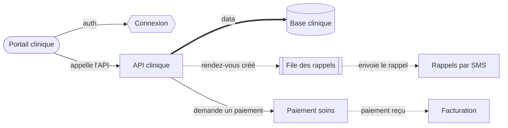

# test-envoi-github

> Projet généré par LONKOO à partir d'un canvas d'architecture. Le code est un point de départ : ce qui reste à écrire est indiqué plus bas.

## Sécurité : à lire avant de déployer

**L'API générée n'a pas d'authentification** : toute personne qui connaît son adresse peut lire, créer, modifier et supprimer les données. Le bloc d'authentification du canvas est décrit dans la documentation, mais il n'est pas codé. Avant de la mettre sur une adresse publique avec de vraies données, ajoutez l'authentification et changez les mots de passe (voir `.env.example`).

## Architecture



Détail dans [docs/architecture](docs/architecture/architecture.md).

## Démarrer

Prérequis : Docker et Docker Compose.

```bash
docker compose up --build
```

- API : <http://localhost:8080> (santé : `/actuator/health`)
- Interface `frontend` : <http://localhost:3000>
- Contrat d'API : [openapi.yaml](openapi.yaml)

Les valeurs par défaut conviennent au développement local ; en production, copier `.env.example` en `.env` et changer les mots de passe.

## Blocs du canvas

| Bloc | Type | Génération |
|---|---|---|
| Portail clinique | Application web | Application Next.js : une route par page (`frontend/`). |
| Connexion | Authentification | *À implémenter* : méthode choisie `otp-sms`. |
| API clinique | Service | Contrôleur REST (`backend/`) : CRUD complet pour les endpoints qui portent le nom d'une table, squelette « 501 À implémenter » pour les autres. |
| Base clinique | Base de données | Migration SQL, entités JPA et dépôts (`backend/`). |
| File des rappels | File de messages | *À implémenter* : file de messages et ses topics. |
| Rappels par SMS | Messagerie | *À implémenter* : envoi de messages (aucune intégration fournie). |
| Paiement soins | Paiement mobile | *À implémenter* : passerelle de paiement mobile (aucune intégration fournie). |
| Facturation | Facturation | *À implémenter* : facturation. |

## À compléter

- Les endpoints du canvas qui portent le nom d'une table ont un CRUD complet ; relisez-les avant de les exposer (les entités sont renvoyées telles quelles).
- Authentification, files de messages, paiement, messagerie et facturation : aucune intégration réelle n'est générée.
- Aucun test n'est généré.

## Déploiement sur un serveur Systalink

Le fichier `.github/workflows/deploy-systalink.yml` (déclenché à la main, ou par LONKOO) envoie le projet par SSH et lance `docker compose up -d --build`. Créez d'abord ces secrets dans les réglages du dépôt (*Settings › Secrets and variables › Actions*) :

| Secret | Contenu |
|---|---|
| `SYSTALINK_SSH_HOST` | adresse du serveur |
| `SYSTALINK_SSH_USER` | utilisateur de déploiement |
| `SYSTALINK_SSH_PRIVATE_KEY` | clé privée SSH de cet utilisateur |
| `SYSTALINK_SSH_KNOWN_HOSTS` | résultat de `ssh-keyscan <adresse>` (vérification de l'identité du serveur) |

---

Généré par LONKOO.
