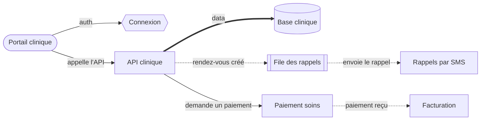

# Architecture de test-envoi-github

Ce dossier décrit l'architecture dessinée dans LONKOO. Le schéma ci-dessous s'affiche directement sur GitHub.

## Blocs

| Bloc | Type | Génération |
|---|---|---|
| Portail clinique | Application web | Application Next.js : une route par page (`frontend/`). |
| Connexion | Authentification | *À implémenter* : méthode choisie `otp-sms`. |
| API clinique | Service | Contrôleur REST (`backend/`) : CRUD complet pour les endpoints qui portent le nom d'une table, squelette « 501 À implémenter » pour les autres. |
| Base clinique | Base de données | Migration SQL, entités JPA et dépôts (`backend/`). |
| File des rappels | File de messages | *À implémenter* : file de messages et ses topics. |
| Rappels par SMS | Messagerie | *À implémenter* : envoi de messages (aucune intégration fournie). |
| Paiement soins | Paiement mobile | *À implémenter* : passerelle de paiement mobile (aucune intégration fournie). |
| Facturation | Facturation | *À implémenter* : facturation. |

## Modèle de données

Voir [data-model.md](data-model.md).

## Source

[canvas.json](canvas.json) est l'instantané du canvas dont ce dépôt est tiré (contrat LONKOO, version 1).
