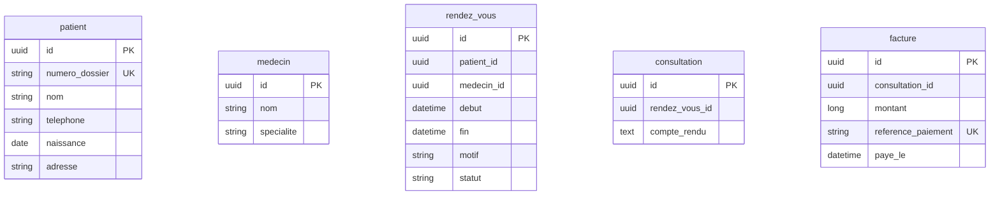

# Modèle de données

Les tables ci-dessous sont créées par la migration `backend/src/main/resources/db/migration/V1__schema_initial.sql`.

## patient

Classe `Patient`.

| Colonne | Type | Contraintes |
|---|---|---|
| id | uuid | clé primaire |
| numero_dossier | string | obligatoire, unique |
| nom | string | obligatoire |
| telephone | string | obligatoire |
| naissance | date |  |
| adresse | string |  |

## medecin

Classe `Medecin`.

| Colonne | Type | Contraintes |
|---|---|---|
| id | uuid | clé primaire |
| nom | string | obligatoire |
| specialite | string | obligatoire |

## rendez_vous

Classe `RendezVous`.

| Colonne | Type | Contraintes |
|---|---|---|
| id | uuid | clé primaire |
| patient_id | uuid | obligatoire |
| medecin_id | uuid | obligatoire |
| debut | datetime | obligatoire |
| fin | datetime | obligatoire |
| motif | string |  |
| statut | string | obligatoire |

## consultation

Classe `Consultation`.

| Colonne | Type | Contraintes |
|---|---|---|
| id | uuid | clé primaire |
| rendez_vous_id | uuid | obligatoire |
| compte_rendu | text |  |

## facture

Classe `Facture`.

| Colonne | Type | Contraintes |
|---|---|---|
| id | uuid | clé primaire |
| consultation_id | uuid | obligatoire |
| montant | long | obligatoire |
| reference_paiement | string | unique |
| paye_le | datetime |  |

